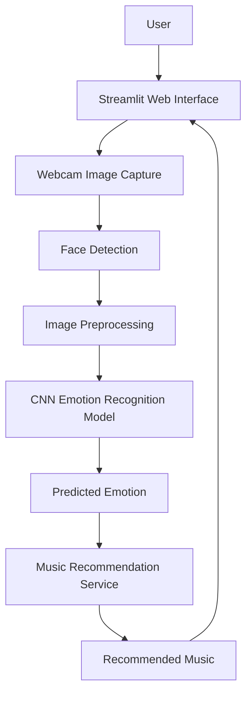

# 🎵 Mood-Based Music Recommendation System

A machine learning-based application that detects facial emotions using a webcam and recommends music based on the user's predicted mood.

## 📌 Project Overview

The **Mood-Based Music Recommendation System** combines computer vision, deep learning, and personalized music recommendations to create an interactive experience.

The application captures facial expressions through a webcam, detects the user's face, and uses a Convolutional Neural Network (CNN) to classify the facial expression into an emotion category. Based on the predicted emotion, and  the system recommends music intended to match the user's mood.

The project is developed using Python, TensorFlow/Keras, OpenCV, and Streamlit.

## ✨ Features

- **Facial Emotion Recognition:** Predicts emotions from facial expressions using a trained CNN model.
- **Real-Time Webcam Input:** Captures facial images through a webcam.
- **Face Detection:** Processes facial regions for emotion prediction.
- **Mood-Based Music Recommendations:** Suggests music based on the predicted emotion.
- **Interactive Web Interface:** Provides a user-friendly interface through Streamlit.
- **Modular Architecture:** Separates application logic, model prediction, preprocessing, and music recommendation functionality.

## 🧠 Emotion Recognition

The application is designed to recognize the following emotion categories, depending on the model configuration:

- Angry
- Fear
- Happy
- Sad
- Surprise
- Neutral

The model used in the current application is `best_emotion_model_v3.keras`.

*Note: The actual emotion categories depend on the model's training configuration. Confirm the configured class labels before treating this list as definitive.*

## 🏗️ System Architecture



### Workflow

1. The user opens the Streamlit application.
2. The application captures an image from the webcam.
3. The face detection module locates the face.
4. The detected face is preprocessed to match the model's expected input.
5. The trained CNN predicts the facial emotion.
6. The music recommendation service selects recommendations associated with the predicted emotion.
7. The application presents the prediction and recommendations to the user.

## 🛠️ Technologies Used

| Technology | Purpose |
|---|---|
| Python | Core programming language |
| TensorFlow / Keras | CNN model development and inference |
| OpenCV | Image processing and face detection |
| Streamlit | Interactive web application |
| NumPy | Numerical operations and image arrays |
| Git and GitHub | Version control and source code hosting |

## 📂 Project Structure

```text
MoodBasedMusic/
├── app.py
├── camera_test.py
├── emotion_camera.py
├── evaluate_model.py
├── face_detection.py
├── predict_emotion.py
├── requirements.txt
├── train_model.py
├── train_model_v4.py
├── .gitignore
├── model/
│   └── best_emotion_model_v3.keras
├── services/
│   └── music_recommender.py
└── utils/
    ├── check_ckplus.py
    ├── check_image.py
    ├── dataset_info.py
    ├── prepare_ckplus.py
    ├── preprocess.py
    └── visualize_dataset.py
```

## ⚙️ Installation

### Prerequisites

- Python 3.10 or another Python version compatible with the dependencies
- Git
- A working webcam
- A supported web browser

### 1. Clone the repository

```bash
git clone https://github.com/the-name-is-yesh/MoodBasedMusic.git
cd MoodBasedMusic
```

### 2. Create a virtual environment

**Windows:**

```powershell
python -m venv venv
.\venv\Scripts\Activate.ps1
```

If PowerShell blocks activation, you can use Command Prompt instead:

```bat
venv\Scripts\activate.bat
```

### 3. Install dependencies

```bash
python -m pip install --upgrade pip
pip install -r requirements.txt
```

### 4. Verify the model file

Make sure this file exists:

```text
model/best_emotion_model_v3.keras
```

The trained model is included in the repository. The training datasets are not included and must be obtained separately if you want to retrain the model.

## ▶️ Usage

### Run the application

From the project root, execute:

```bash
streamlit run app.py
```

Open the local URL printed in the terminal, typically:

```text
http://localhost:8501
```

### Use the application

1. Allow webcam access if prompted.
2. Position your face clearly in front of the camera.
3. Ensure the lighting is sufficient.
4. Allow the application to predict your facial emotion.
5. View the music recommendations associated with the prediction.

The exact interaction depends on the controls implemented in `app.py`.

## 🏋️ Model Training and Evaluation

The repository includes scripts for training, preprocessing, dataset inspection, and model evaluation.

- `train_model.py` — model training workflow.
- `train_model_v4.py` — an experimental training version.
- `evaluate_model.py` — model evaluation.
- `utils/preprocess.py` — image preprocessing utilities.
- `utils/prepare_ckplus.py` — CK+ CSV preprocessing utility.

To train or evaluate the model, first obtain a suitable dataset, verify its usage permissions, and configure the scripts to point to the correct dataset location.

**Important:** The currently selected V3 model is the application's candidate model. Experimental models should not replace it unless they have been evaluated appropriately.

## ⚠️ Limitations

- **Prediction accuracy:** Emotion recognition is imperfect and may misclassify facial expressions.
- **Dataset limitations:** Model performance depends on the quality, size, diversity, and labeling of the training data.
- **Lighting and camera quality:** Poor lighting, low-resolution images, and face positioning can affect predictions.
- **Individual differences:** Facial expressions do not reliably reveal a person's actual emotional state.
- **Recommendation scope:** Recommendations depend on the mapping and selection logic implemented in the music recommendation service.
- **Hardware requirements:** TensorFlow and image processing require suitable system resources.
- **Privacy:** Webcam access is required for camera-based functionality. Users should understand how images are processed before using the application.
- **Deployment:** Webcam access and native computer vision dependencies may require additional configuration on cloud-hosted platforms.

This application is intended for educational and demonstration purposes. Its predictions should not be treated as a psychological assessment or a definitive measure of a person's mood.

## 🔮 Future Enhancements

- Improve emotion recognition through better data balancing and model evaluation.
- Add confidence scores and more detailed evaluation metrics.
- Expand music recommendations with user preferences and listening history.
- Integrate a music streaming API where appropriate.
- Improve the user interface and recommendation explanations.
- Explore deployment options that support the application's webcam and machine learning requirements.

## 🤝 Contributing

Contributions, suggestions, and bug reports are welcome.

1. Fork the repository.
2. Create a feature branch.
3. Make your changes.
4. Test your changes.
5. Submit a pull request describing your improvements.

## 📄 License

No license has been specified yet. Unless a license is added, others generally do not receive permission to reuse, modify, or distribute the project simply because the repository is public.

Add an appropriate open-source license after confirming that you have the rights to license the code and any included assets.

## 👨‍💻 Author

**Yesh**

GitHub: [@the-name-is-yesh](https://github.com/the-name-is-yesh)

---

⭐ If you find this project interesting, consider starring the repository!
